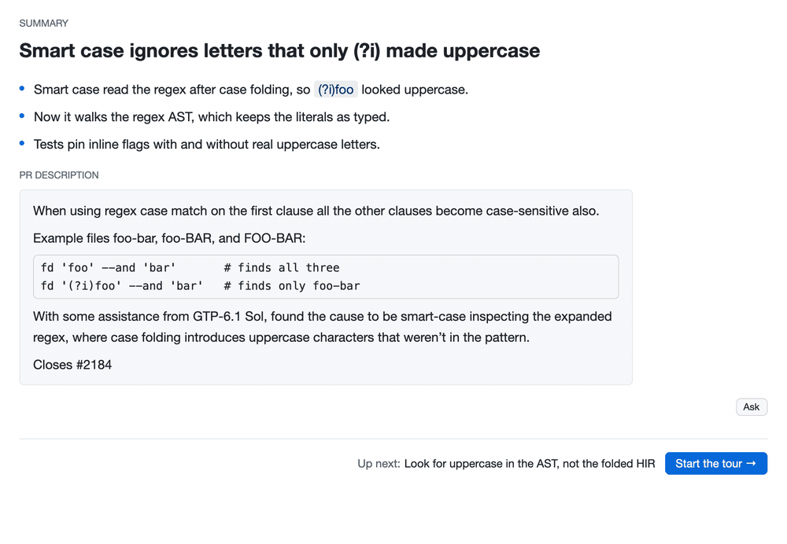

# guided-review

Turn a PR diff into a top-down guided review. An agent writes a tour of a GitHub PR: a summary, then steps from the main flow down to the details, each with the diff pieces and diagrams it talks about. The app shows the tour next to the diff and lets you comment on it.



## Tour

The tour of [sharkdp/fd#2185](https://github.com/sharkdp/fd/pull/2185), a merged public PR.


The summary and the PR description, with the steps listed on the left.


A step: what to check, a diagram, then the diff pieces it talks about.


GitHub review threads sit inline in the diff, where you can reply and resolve.

## Requirements

- macOS (the only platform tested; CI runs on macOS).
- A Rust toolchain, stable (edition 2024), only to build from source.
- [`gh`](https://cli.github.com), logged in. The app reads the token from `gh auth token`.
- [Claude Code](https://claude.com/claude-code) (`claude`), which writes the tours.
- [herdr](https://herdr.dev) (`hc` and `herdr-app`), only for the agent features: the PR switcher starting a tour writer, comments reaching the tour's agent, Refresh. Without herdr the app turns those features off and says why; opening and reading an existing tour does not need it.

## Install

### Let your agent do it

Paste this into Claude Code (or any coding agent with a shell):

```text
Install guided-review (https://github.com/ekvedaras/guided-review) for me from its latest GitHub release. Do it yourself, one step at a time, and stop and tell me if any step fails:
1. Find my Mac's architecture with `uname -m`: arm64 means target aarch64-apple-darwin, x86_64 means x86_64-apple-darwin. Stop if this is not macOS.
2. Find the latest release and its assets: `gh release view --repo ekvedaras/guided-review --json tagName,assets` (or, without gh, https://api.github.com/repos/ekvedaras/guided-review/releases/latest). Pick guided-review-<version>-<target>.tar.gz and its .sha256.
3. Download both into a new empty folder ~/.local/share/guided-review/<version>/, check the archive with `shasum -a 256 -c <archive>.sha256`, and unpack it there with `tar xzf`.
4. Link the binary: `mkdir -p ~/.local/bin` and `ln -sf` the unpacked guided-review binary to ~/.local/bin/guided-review. Remove the macOS quarantine flag from the unpacked binary with `xattr -d com.apple.quarantine <path>` (ignore "No such xattr").
5. Link the tour skill: point ~/.claude/skills/tour at the unpacked skills/tour folder with `ln -sfn`. If ~/.claude/skills/tour exists and is a real folder rather than a link, ask me before replacing it.
6. If ~/.local/bin is not on my PATH, tell me which line to add to my shell profile; do not edit it yourself.
7. Run `guided-review --version` and tell me the installed version.
```

To update later, paste the same prompt again: each version unpacks into its own folder and the links move to the newest.

### Prebuilt (no Rust needed)

Download the archive for your Mac from the [latest release](https://github.com/ekvedaras/guided-review/releases/latest): `aarch64-apple-darwin` for Apple Silicon, `x86_64-apple-darwin` for Intel. Then:

```sh
VERSION=0.1.0 TARGET=aarch64-apple-darwin   # the release you downloaded
shasum -a 256 -c guided-review-$VERSION-$TARGET.tar.gz.sha256   # optional
tar xzf guided-review-$VERSION-$TARGET.tar.gz
mkdir -p ~/.local/bin
mv guided-review-$VERSION-$TARGET/guided-review ~/.local/bin/
```

`~/.local/bin` must be on `PATH`, also for agents the app starts.

The binary is not signed or notarized, so macOS Gatekeeper blocks a downloaded copy. Remove the quarantine flag once:

```sh
xattr -d com.apple.quarantine ~/.local/bin/guided-review
```

Link the tour skill from the unpacked folder so Claude Code finds `/tour`. Keep that folder, the link points into it:

```sh
mkdir -p ~/.claude/skills
ln -s "$PWD/guided-review-$VERSION-$TARGET/skills/tour" ~/.claude/skills/tour
```

The CLI embeds the skill, so keep both from the same release.

### From source

```sh
cargo install --path .
```

The `guided-review` binary must be on `PATH`, also for agents the app starts.

Link the tour skill so Claude Code finds `/tour`:

```sh
ln -s "$PWD/skills/tour" ~/.claude/skills/tour
```

The CLI embeds the skill, so keep both from the same checkout.

## Use

In Claude Code:

```
/tour <pr-url>
```

The skill writes the tour with the `guided-review` CLI and opens it. To open an existing tour:

```sh
guided-review open <pr-url>
```

Tours and app state live under `~/.guided-review/`. `guided-review --help` lists the other commands (`outline`, `show`, `check`, `repin`, `refresh`, `eval`).

## How it works

[GLOSSARY.md](GLOSSARY.md) defines the words (tour, step, piece). [docs/wiki](docs/wiki/index.md) records the decisions and why.

## Contributing

Read [CODING_STANDARDS.md](CODING_STANDARDS.md) first. The [wiki](docs/wiki/index.md) records decisions. `scripts/check` is the gate before every commit.
