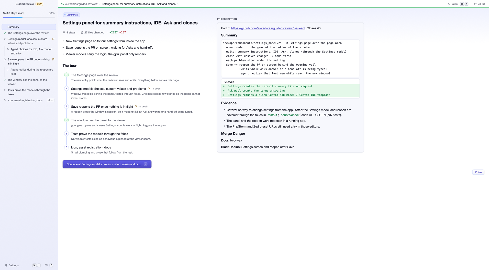
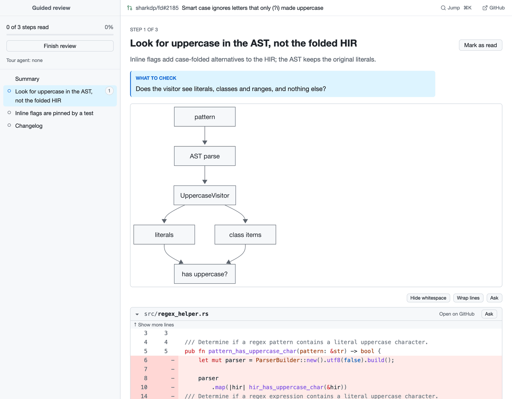
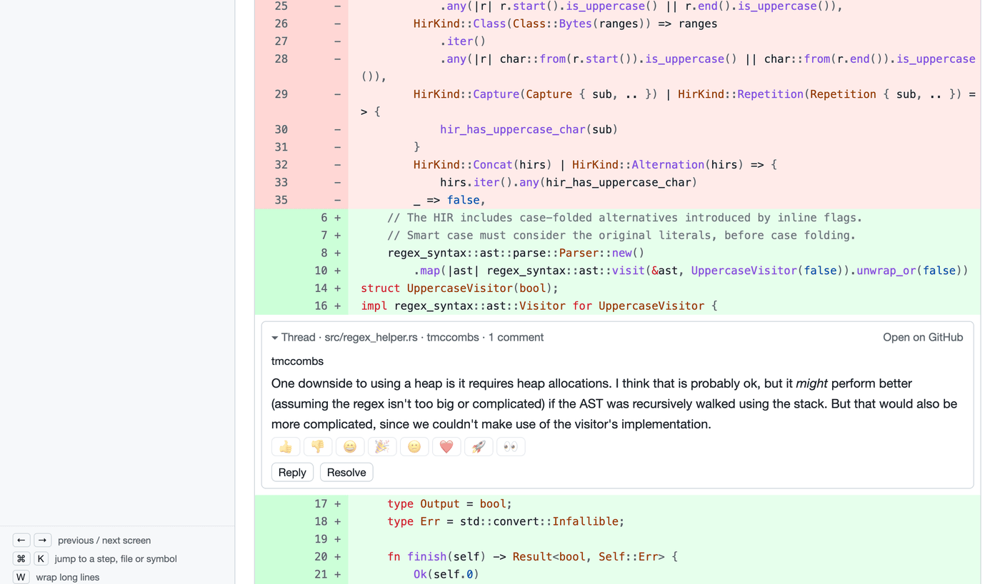

# guided-review

Turn a PR diff into a top-down guided review. An agent writes a tour of a GitHub PR: a summary, then steps from the main flow down to the details, each with the diff pieces and diagrams it talks about. The app shows the tour next to the diff and lets you comment on it.

> [!NOTE]
> Mandatory `vibe` alert! I do not have the capacity to review all of this code. The irony here is not lost on me 🙃 I do care, PRs and issues are welcome!

## Install with your agent

Paste this into Claude Code (or any coding agent with a shell):

```text
Install guided-review (https://github.com/ekvedaras/guided-review) for me from its latest GitHub release. Do it yourself, one step at a time, and stop and tell me if any step fails:
1. Find my Mac's architecture with `uname -m`: arm64 means target aarch64-apple-darwin, x86_64 means x86_64-apple-darwin. Stop if this is not macOS.
2. Check what it needs and tell me what is missing, but go on: `gh auth status` (gh, logged in), `command -v claude` (Claude Code) and `command -v hc` (herdr, only for the agent features).
3. Find the latest release and its assets: `gh release view --repo ekvedaras/guided-review --json tagName,assets` (or, without gh, https://api.github.com/repos/ekvedaras/guided-review/releases/latest). The version is the tag without its leading v. Pick guided-review-<version>-<target>.tar.gz and guided-review-<version>-<target>.tar.gz.sha256.
4. Make the folder ~/.local/share/guided-review/<version>/ and, inside it, download both files, check the archive with `shasum -a 256 -c <archive>.sha256` and unpack it with `tar xzf <archive>`. It unpacks to guided-review-<version>-<target>/, holding the guided-review binary, skills/tour and Guided Review.app; that folder is the release folder below.
5. Link the binary: `mkdir -p ~/.local/bin`, then `ln -sf <release folder>/guided-review ~/.local/bin/guided-review`. Remove the macOS quarantine flag from that binary with `xattr -d com.apple.quarantine <path>` (ignore "No such xattr").
6. Link the tour skill: `mkdir -p ~/.claude/skills`, then `ln -sfn <release folder>/skills/tour ~/.claude/skills/tour`. If ~/.claude/skills/tour exists and is a real folder rather than a link, ask me before replacing it.
7. Put the app in ~/Applications: run `<release folder>/guided-review install-app`. It makes ~/Applications/Guided Review.app, for the Dock, Spotlight and Raycast.
8. Run `which -a guided-review`. If ~/.local/bin is not on my PATH, tell me which line to add to my shell profile; do not edit it yourself. If another guided-review comes before ~/.local/bin/guided-review (an old `cargo install` in ~/.cargo/bin, say), tell me: it would run instead of this install and never get its updates.
9. Run `~/.local/bin/guided-review --version` and tell me the installed version and how to start: Guided Review from Spotlight, or `/tour <pr-url>` in Claude Code.
```

After that, the app updates itself: when a newer release is out, an Update button shows in the sidebar, above Settings. One click downloads it, checks it, moves the links to it, refreshes Guided Review.app and restarts the app. Each version keeps its own folder, so the old one is still there.

Guided Review.app starts the app from the Dock, Spotlight or Raycast and shows the PR switcher to pick a PR. It runs the app through your login shell, so `gh`, `claude` and `hc` are found as in a terminal.

Other ways to install, and what it needs: [Requirements](#requirements) and [Install](#install).

## Tour

The tour of [ekvedaras/guided-review#12](https://github.com/ekvedaras/guided-review/pull/12), the PR that added the Settings page.

<picture>
  <source media="(prefers-color-scheme: dark)" srcset="docs/assets/tour-summary-dark.png">
  
</picture>

The summary and the PR description beside it. The sidebar lists the steps and how far you have read.

<picture>
  <source media="(prefers-color-scheme: dark)" srcset="docs/assets/tour-step-diagram-dark.png">
  
</picture>

A step: what to check, a diagram, then the diff pieces it talks about. Changed words are marked inside rewritten lines.

<picture>
  <source media="(prefers-color-scheme: dark)" srcset="docs/assets/tour-step-thread-dark.png">
  
</picture>

Comments and GitHub review threads sit inline in the diff, in a box that splits it. Add a comment to your review, send it now, or hand it to the tour's agent.

## Requirements

- macOS (the only platform tested; CI runs on macOS).
- A Rust toolchain, stable (edition 2024), only to build from source.
- [`gh`](https://cli.github.com), logged in. The app reads the token from `gh auth token`.
- [Claude Code](https://claude.com/claude-code) (`claude`), which writes the tours.
- [herdr](https://herdr.dev) (`hc` and `herdr-app`), only for the agent features: the PR switcher starting a tour writer, comments reaching the tour's agent, Refresh. Without herdr the app turns those features off and says why; opening and reading an existing tour does not need it.

## Install

### Prebuilt (no Rust needed)

Each release has an archive per Mac: `aarch64-apple-darwin` for Apple Silicon, `x86_64-apple-darwin` for Intel. Unpack it into its own version folder and link the binary and the tour skill into it. The app updates itself only when it is installed this way:

```sh
TARGET=aarch64-apple-darwin   # x86_64-apple-darwin on Intel
VERSION=$(gh release view --repo ekvedaras/guided-review --json tagName -q .tagName | sed 's/^v//')
ARCHIVE=guided-review-$VERSION-$TARGET.tar.gz
mkdir -p ~/.local/share/guided-review/$VERSION ~/.local/bin ~/.claude/skills
cd ~/.local/share/guided-review/$VERSION
gh release download v$VERSION --repo ekvedaras/guided-review --pattern "$ARCHIVE*"
shasum -a 256 -c $ARCHIVE.sha256
tar xzf $ARCHIVE
RELEASE=$PWD/guided-review-$VERSION-$TARGET
ln -sf "$RELEASE/guided-review" ~/.local/bin/guided-review
ln -sfn "$RELEASE/skills/tour" ~/.claude/skills/tour
"$RELEASE/guided-review" install-app   # ~/Applications/Guided Review.app
```

`~/.local/bin` must be on `PATH`, also for agents the app starts, and come before any other `guided-review` (check with `which -a guided-review`). One found first, such as an old `cargo install` in `~/.cargo/bin`, runs instead of the release install and never gets its updates; the app names it as a problem until it is removed.

The binary is not signed or notarized. Files downloaded with `gh` or `curl` carry no quarantine flag, but if you downloaded the archive with a browser, macOS Gatekeeper blocks it until you remove the flag once:

```sh
xattr -d com.apple.quarantine "$RELEASE/guided-review"
```

The CLI embeds the skill, so keep both from the same release. An update the app installs needs no quarantine step.

### From source

```sh
git clone https://github.com/ekvedaras/guided-review && cd guided-review
cargo install --path . --locked
mkdir -p ~/.claude/skills
ln -sfn "$PWD/skills/tour" ~/.claude/skills/tour   # so Claude Code finds /tour
```

The `guided-review` binary (in `~/.cargo/bin`) must be on `PATH`, also for agents the app starts. The CLI embeds the skill, so keep both from the same checkout.

A build from source never updates itself and has no Guided Review.app (`install-app` works only for a release install): start the app with `guided-review` or `guided-review open <pr-url>`. Do not keep it beside a release install, or the app warns that it is in the release install's way.

## Use

In Claude Code:

```
/tour <pr-url>
```

The skill writes the tour with the `guided-review` CLI and opens it. `guided-review` with no command, like Guided Review.app, shows the PR switcher. To open a PR in the app:

```sh
guided-review open <pr-url>
```

A PR with no tour yet gets one written, as when you pick it in the PR switcher: the app shows the writer's progress and opens the tour when it is ready (needs herdr).

In the app, `→` or `J` (the Next button) goes on to the next step not read yet, `N` jumps to the next unread step from anywhere, `M` marks a step read, `⌘K` jumps to a step, file or action (Settings, Finish review, Restart app here, which `guided-review restart` also does), `G` opens the PR on GitHub, `?` lists every shortcut and `⌘W` or `⌘Q` quits the app. With summary instructions set in Settings, the tour can also carry a reviewer summary; pictures it shows sit in the tour's own folder.

Tours and app state live under `~/.guided-review/`. `guided-review --help` lists the other commands (`outline`, `tour-path`, `show`, `check`, `repin`, `refresh`, `settings`, `restart`, `install-app`, `agent-reply`, `eval`).

## How it works

[GLOSSARY.md](GLOSSARY.md) defines the words (tour, step, piece). [docs/wiki](docs/wiki/index.md) records the decisions and why.

## Contributing

Read [CODING_STANDARDS.md](CODING_STANDARDS.md) first. The [wiki](docs/wiki/index.md) records decisions. `scripts/check` is the gate before every commit.
